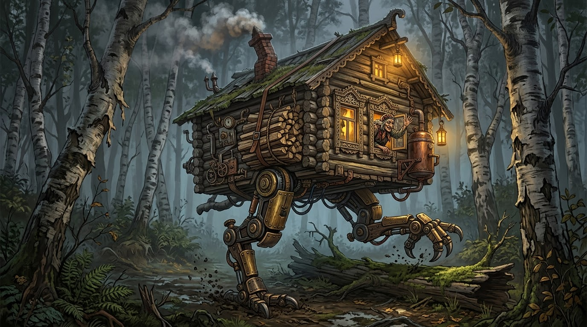

# ТЗ: Ходячая избушка «Бабкин Экспресс»
Автор: Харченко Владислав Андреевич

Стихия: Земля

Проект: Избушка на курьих ножках «Бабкин Экспресс»

Репозиторий: https://github.com/Vld555/crazy_vehicle

Дата заморозки: —

Версия: 0.1

# 1. Назначение
Избушка на курьих ножках «Бабкин Экспресс» — шагающее жилое средство передвижения по суше.
Передвигается на двух механических курьих ногах шагом или бегом, умеет присаживаться, вставать,
перешагивать препятствия и поворачиваться «к лесу задом, к путнику передом».
Источник энергии — печь, которую топят дровами; подбросить дров можно, только когда избушка сидит.



# 2. Стихия и конструкционный элемент

Стихия: Земля

- Конструкционный элемент:
    - Две курьи ноги (атрибуты `leg_length_m`, `healthy_legs`) — обеспечивают сцепление с грунтом и передвижение по земле.
      Длина ног определяет скорость и высоту препятствий, которые можно перешагнуть.
      С одной здоровой ногой избушка хромает (медленнее, дороже, не бегает и не перешагивает),
      без здоровых ног — не может ходить и сидит.
    - Печь с дровами (атрибут `firewood`) — источник энергии для любого движения.
- Ограничения стихии:
    - Передвигается только по земле и только ногами (шаг, бег, перешагивание).
    - Не летает, не плавает, не роет.
    - Сидя не передвигается и не поворачивается.

# 3. Публичный интерфейс

### 3.1. Класс
- class: `WalkingHut`
- Модуль: `walking_hut/walking_hut.py`, импорт: `from walking_hut import WalkingHut`

### 3.2. Конструктор
```python
def __init__(
    self,
    name: str,
    mass_kg: float,
    leg_length_m: float,
    firewood: float = 100.0,
) -> None:
```
| Параметр     | Тип   | Единица          | Допустимый диапазон | Значение по умолчанию | Описание                     |
|--------------|-------|------------------|---------------------|-----------------------|------------------------------|
| name         | str   | —                | непустая строка     | —                     | Имя избушки                  |
| mass_kg      | float | кг               | 300.0 … 3000.0      | —                     | Масса избушки                |
| leg_length_m | float | м                | 0.5 … 5.0           | —                     | Длина курьих ног             |
| firewood     | float | условные единицы | 0.0 … 100.0         | 100.0                 | Начальный запас дров в печи  |

Границы диапазонов включительно. Числовые параметры принимают `int` или `float` (`bool` не допускается).

**Начальное состояние:** `position_m == 0.0`, `pose == "standing"`, `facing == "forest"`, `healthy_legs == 2`.

**Исключения конструктора** (проверяются в порядке перечисления):
- TypeError — если `name` не `str` или числовой параметр не `int`/`float` (или является `bool`).
- ValueError — если `name` пустой или состоит только из пробелов. **Текст ошибки:** "Имя не может быть пустым."
- ValueError — если `mass_kg` вне 300.0…3000.0. **Текст ошибки:** "Масса должна быть в диапазоне 300…3000 кг."
- ValueError — если `leg_length_m` вне 0.5…5.0. **Текст ошибки:** "Длина ног должна быть в диапазоне 0.5…5.0 м."
- ValueError — если `firewood` вне 0…100. **Текст ошибки:** "Запас дров должен быть в диапазоне 0…100."

### 3.3. Атрибуты
Все атрибуты доступны только для чтения.

| Атрибут      | Тип   | Единица          | Доступ | Описание                                            |
|--------------|-------|------------------|--------|-----------------------------------------------------|
| name         | str   | —                | чтение | Имя избушки                                         |
| mass_kg      | float | кг               | чтение | Масса                                               |
| leg_length_m | float | м                | чтение | Длина ног                                           |
| firewood     | float | условные единицы | чтение | Текущий запас дров, 0…100                           |
| position_m   | float | м                | чтение | Пройденное расстояние                               |
| pose         | str   | —                | чтение | Поза: `"standing"` (стоит) или `"sitting"` (сидит)  |
| facing       | str   | —                | чтение | Куда повёрнута: `"forest"` (к лесу) или `"traveler"` (к путнику) |
| healthy_legs | int   | шт.              | чтение | Число здоровых ног, 0…2                             |

### 3.4. Методы

Общие обозначения:
- **Стоимость шага** `step_cost = mass_kg / 50000` — дров на 1 метр ходьбы на двух ногах
  (для 1000 кг — 0.02 на метр, т. е. 2.0 на 100 м).
- **Скорость шага** `walk_speed = leg_length_m * 10` — м/мин на двух ногах (для ног 2.0 м — 20 м/мин).
- **Хромота** — `healthy_legs == 1`.
- Если метод выбросил исключение, состояние избушки **не меняется**.

#### 3.4.1. walk
```python
def walk(self, distance_m: float) -> float:
```
**Назначение:** пройти шагом заданное расстояние.

**Параметры:** `distance_m` — расстояние в метрах, > 0.

**Возвращает:** время в пути в минутах (`float`).

**Изменяет:** `position_m`, `firewood`.

**Исключения** (проверяются в порядке перечисления):
- TypeError — `distance_m` не `int`/`float` (или `bool`).
- ValueError — `distance_m <= 0`. **Текст:** "Расстояние должно быть больше 0."
- HutCannotWalk — `healthy_legs == 0`. **Текст:** "Избушка не может идти: обе ноги сломаны."
- HutIsSitting — `pose == "sitting"`. **Текст:** "Избушка сидит. Сначала встаньте."
- HutOutOfFirewood — дров меньше, чем требуется. **Текст:** "Не хватает дров в печи."

**Правила:**
- На двух ногах: скорость = `walk_speed`, расход = `distance_m * step_cost`.
- Хромая: скорость = `walk_speed * 0.5`, расход = `distance_m * step_cost * 2`.
- Время = `distance_m / скорость`.
- Если дров ровно столько, сколько нужно, — движение выполняется, `firewood` становится 0.0.
- `position_m += distance_m`, `firewood -= расход`.

#### 3.4.2. run
```python
def run(self, distance_m: float) -> float:
```
**Назначение:** пробежать заданное расстояние.

**Параметры:** `distance_m` — расстояние в метрах, > 0.

**Возвращает:** время в пути в минутах (`float`).

**Изменяет:** `position_m`, `firewood`.

**Исключения** (в порядке перечисления):
- TypeError, ValueError, HutCannotWalk, HutIsSitting — как у `walk`.
- HutIsLame — `healthy_legs == 1`. **Текст:** "Избушка хромает: действие требует двух здоровых ног."
- HutOutOfFirewood — дров меньше, чем требуется. **Текст:** "Не хватает дров в печи."

**Правила:**
- Скорость = `walk_speed * 2`, расход = `distance_m * step_cost * 3`.
- `position_m += distance_m`, `firewood -= расход`.

#### 3.4.3. sit_down
```python
def sit_down(self) -> None:
```
**Назначение:** присесть.

**Изменяет:** `pose` → `"sitting"`. Дрова не расходуются.

**Исключения:**
- HutWrongPose — уже сидит. **Текст:** "Избушка уже сидит."

#### 3.4.4. stand_up
```python
def stand_up(self) -> None:
```
**Назначение:** встать.

**Изменяет:** `pose` → `"standing"`, `firewood -= 1.0`.

**Исключения** (в порядке перечисления):
- HutWrongPose — уже стоит. **Текст:** "Избушка уже стоит."
- HutCannotWalk — `healthy_legs == 0`. **Текст:** "Избушка не может идти: обе ноги сломаны."
- HutOutOfFirewood — `firewood < 1.0`. **Текст:** "Не хватает дров в печи."

**Правила:** встать можно и на одной здоровой ноге.

#### 3.4.5. turn_around
```python
def turn_around(self) -> None:
```
**Назначение:** «Избушка, избушка, стань ко мне передом, к лесу задом» — развернуться на месте.

**Изменяет:** `facing` (`"forest"` ↔ `"traveler"`), `firewood -= 0.5`. `position_m` не меняется.

**Исключения** (в порядке перечисления):
- HutIsSitting — `pose == "sitting"`. **Текст:** "Избушка сидит. Сначала встаньте."
- HutOutOfFirewood — `firewood < 0.5`. **Текст:** "Не хватает дров в печи."

**Правила:** разворот возможен и на одной ноге.

#### 3.4.6. can_step_over
```python
def can_step_over(self, obstacle: str) -> bool:
```
**Назначение:** проверить, может ли избушка перешагнуть препятствие. Состояние не меняет, дрова не расходует.

**Параметры:** `obstacle` — тип препятствия:

| obstacle    | Высота, м |
|-------------|-----------|
| `"log"`     | 0.5       |
| `"fence"`   | 1.5       |
| `"boulder"` | 2.5       |
| `"wall"`    | 4.0       |

**Возвращает:** `True`, если одновременно: `pose == "standing"`, `healthy_legs == 2`, `leg_length_m >= высота`; иначе `False`.

**Исключения:**
- TypeError — `obstacle` не `str`.
- ValueError — препятствие не из таблицы. **Текст:** "Неизвестное препятствие."

Запас дров на результат не влияет.

#### 3.4.7. step_over
```python
def step_over(self, obstacle: str) -> None:
```
**Назначение:** перешагнуть препятствие.

**Параметры:** `obstacle` — как в `can_step_over`.

**Изменяет:** `firewood -= 3.0`. `position_m` не меняется.

**Исключения** (в порядке перечисления):
- TypeError — `obstacle` не `str`.
- ValueError — препятствие не из таблицы. **Текст:** "Неизвестное препятствие."
- HutIsSitting — `pose == "sitting"`. **Текст:** "Избушка сидит. Сначала встаньте."
- HutIsLame — `healthy_legs == 1`. **Текст:** "Избушка хромает: действие требует двух здоровых ног."
- HutCannotStepOver — `leg_length_m < высота`. **Текст:** "Ноги слишком короткие для этого препятствия."
- HutOutOfFirewood — `firewood < 3.0`. **Текст:** "Не хватает дров в печи."

#### 3.4.8. add_firewood
```python
def add_firewood(self, amount: float) -> None:
```
**Назначение:** подбросить дров в печь.

**Параметры:** `amount` — количество дров, > 0.

**Изменяет:** `firewood = min(100.0, firewood + amount)`.

**Исключения** (в порядке перечисления):
- TypeError — `amount` не `int`/`float` (или `bool`).
- ValueError — `amount <= 0`. **Текст:** "Количество дров должно быть больше 0."
- HutWrongPose — `pose == "standing"`. **Текст:** "Подбросить дров можно только когда избушка сидит."

#### 3.4.9. damage_leg
```python
def damage_leg(self) -> None:
```
**Назначение:** повредить одну ногу (событие среды: капкан, яма и т. п.).

**Изменяет:** `healthy_legs -= 1`; если стало 0 — `pose` → `"sitting"`. Дрова не расходуются.

**Исключения:**
- HutCannotWalk — `healthy_legs == 0`. **Текст:** "Обе ноги уже сломаны."

#### 3.4.10. get_status
```python
def get_status(self) -> dict:
```
**Назначение:** снимок состояния.

**Возвращает:** словарь ровно с ключами:
`"name"` (str), `"position_m"` (float), `"firewood"` (float), `"pose"` (str), `"facing"` (str), `"healthy_legs"` (int).

# 4. Сценарии

Базовая избушка в сценариях, если не указано иное: `WalkingHut("Избушка", mass_kg=1000.0, leg_length_m=2.0)`,
т. е. `firewood=100.0`, стоит, к лесу, 2 здоровые ноги. Нужное предусловие создаётся только через публичный
интерфейс (`sit_down()`, `damage_leg()`, параметр `firewood` конструктора).

## 4.1 Модульные тесты (паттерн AAA)

#### Конструктор
- **Сценарий 1 (TC-01). Параметры по умолчанию.** Дано: —. Когда: базовая избушка. Тогда: `name="Избушка"`, `mass_kg=1000.0`, `leg_length_m=2.0`, `firewood=100.0`, `position_m=0.0`, `pose="standing"`, `facing="forest"`, `healthy_legs=2`.
- **Сценарий 2 (TC-02). Все параметры явно.** Когда: `WalkingHut("Избушка", 1500.0, 3.0, 40.0)`. Тогда: `mass_kg=1500.0`, `leg_length_m=3.0`, `firewood=40.0`.
- **Сценарий 3 (TC-03). Нижние границы допустимы.** Когда: `WalkingHut("Избушка", 300.0, 0.5, 0.0)`. Тогда: объект создан, `firewood=0.0`.
- **Сценарии 4–11 (TC-04…TC-11). Неверные параметры.** `name=""`, `name="   "`, `mass_kg=299.9`, `mass_kg=3000.1`, `leg_length_m=0.4`, `leg_length_m=5.1`, `firewood=100.5` → ValueError с текстом из 3.2; `mass_kg="1000"` → TypeError.

#### walk / run
- **Сценарий 12 (TC-12). Обычный шаг.** Когда: `walk(100)`. Тогда: возвращает 5.0; `position_m=100.0`; `firewood=98.0`.
- **Сценарий 13 (TC-13). Хромая.** Дано: `damage_leg()` один раз. Когда: `walk(100)`. Тогда: 10.0; `position_m=100.0`; `firewood=96.0`.
- **Сценарий 14 (TC-14).** `walk(0)` → ValueError.
- **Сценарий 15 (TC-15).** `walk("abc")` → TypeError.
- **Сценарий 16 (TC-16). Сидя.** Дано: `sit_down()`. Когда: `walk(10)`. Тогда: HutIsSitting; `position_m=0.0`.
- **Сценарий 17 (TC-17). Нет дров.** Дано: `firewood=1.0`. Когда: `walk(100)`. Тогда: HutOutOfFirewood; `position_m=0.0`, `firewood=1.0`.
- **Сценарий 18 (TC-18). Дров ровно впритык.** Дано: `firewood=2.0`. Когда: `walk(100)`. Тогда: `position_m=100.0`, `firewood=0.0`.
- **Сценарий 19 (TC-19). Бег.** Когда: `run(100)`. Тогда: 2.5; `position_m=100.0`; `firewood=94.0`.
- **Сценарий 20 (TC-20). Бег хромой.** Дано: `damage_leg()`. Когда: `run(10)`. Тогда: HutIsLame; `position_m=0.0`, `firewood=100.0`.

#### sit_down / stand_up / turn_around
- **Сценарий 21 (TC-21).** `sit_down()` → `pose="sitting"`, `firewood=100.0`.
- **Сценарий 22 (TC-22).** Дано: сидит. `stand_up()` → `pose="standing"`, `firewood=99.0`.
- **Сценарий 23 (TC-23).** Стоит, `stand_up()` → HutWrongPose "Избушка уже стоит.".
- **Сценарий 24 (TC-24).** Дано: `damage_leg()` дважды. `stand_up()` → HutCannotWalk; `pose="sitting"`.
- **Сценарий 25 (TC-25).** `turn_around()` → `facing="traveler"`, `firewood=99.5`, `position_m=0.0`.
- **Сценарий 26 (TC-26).** Дано: сидит. `turn_around()` → HutIsSitting; `facing="forest"`.

#### can_step_over / step_over
- **Сценарий 27 (TC-27).** `can_step_over("fence")` → True.
- **Сценарий 28 (TC-28).** `can_step_over("boulder")` → False; `firewood=100.0`.
- **Сценарий 29 (TC-29).** `step_over("fence")` → `firewood=97.0`, `position_m=0.0`.
- **Сценарий 30 (TC-30).** `step_over("wall")` → HutCannotStepOver; `firewood=100.0`.
- **Сценарий 31 (TC-31).** `step_over("river")` → ValueError "Неизвестное препятствие.".

#### add_firewood
- **Сценарий 32 (TC-32).** Дано: `firewood=50.0`, сидит. `add_firewood(30)` → `firewood=80.0`.
- **Сценарий 33 (TC-33).** Дано: `firewood=50.0`, сидит. `add_firewood(1000)` → `firewood=100.0`.
- **Сценарий 34 (TC-34).** Дано: `firewood=50.0`, стоит. `add_firewood(10)` → HutWrongPose; `firewood=50.0`.
- **Сценарий 35 (TC-35).** Дано: сидит. `add_firewood(0)` → ValueError.

#### damage_leg / get_status
- **Сценарий 36 (TC-36).** `damage_leg()` → `healthy_legs=1`, `pose="standing"`.
- **Сценарий 37 (TC-37).** `damage_leg()` дважды → `healthy_legs=0`, `pose="sitting"`.
- **Сценарий 38 (TC-38).** Дано: `damage_leg()` дважды. Третий `damage_leg()` → HutCannotWalk "Обе ноги уже сломаны."; `healthy_legs=0`.
- **Сценарий 39 (TC-39).** `get_status()` → `{"name": "Избушка", "position_m": 0.0, "firewood": 100.0, "pose": "standing", "facing": "forest", "healthy_legs": 2}`.

## 4.2 Функциональные (сценарные) тесты (паттерн GWT)

Сценарные тесты ведутся на доменном языке через тестовую обёртку-пилота **«Баба Яга»** (`tests/pilot.py`),
которая управляет избушкой, и объект среды **«Капкан»**, который повреждает ногу. Обёртки не входят в
продукт и только делегируют вызовы публичному интерфейсу `WalkingHut`:

```python
class BabaYaga:
    """Пилот избушки. Управляет ею на доменном языке."""
    def __init__(self, hut): self._hut = hut
    def пройти(self, distance_m): return self._hut.walk(distance_m)
    def пробежать(self, distance_m): return self._hut.run(distance_m)
    def присесть(self): self._hut.sit_down()
    def встать(self): self._hut.stand_up()
    def стань_ко_мне_передом(self): self._hut.turn_around()
    def можно_перешагнуть(self, obstacle): return self._hut.can_step_over(obstacle)
    def перешагнуть(self, obstacle): self._hut.step_over(obstacle)
    def подкинуть_дров(self, amount): self._hut.add_firewood(amount)
    def осмотреться(self): return self._hut.get_status()

class Kapkan:
    """Капкан в лесу: защемляет одну ногу избушки."""
    def защемить(self, hut): hut.damage_leg()
```

### Сценарий 40 (TC-40): Путник у леса
```
Given базовая избушка (1000 кг, ноги 2.0 м, дров 100), стоит к лесу
When  Баба Яга идёт 300 м
Then  время в пути 15.0 мин
And   пройдено 300 м, дров 94
When  Баба Яга командует «стань ко мне передом»
Then  избушка повёрнута к путнику, дров 93.5
When  Баба Яга присаживает избушку и подкидывает 20 дров
Then  дров 100 (не больше максимума)
Then  итог: position_m=300.0, firewood=100.0, pose="sitting", facing="traveler", healthy_legs=2
```

### Сценарий 41 (TC-41): Полоса препятствий
```
Given базовая избушка
When  Баба Яга перешагивает бревно (log)
Then  дров 97
When  Баба Яга спрашивает, можно ли перешагнуть валун (boulder)
Then  нельзя (False), дров по-прежнему 97
When  Баба Яга идёт 50 м
Then  пройдено 50 м, дров 96
When  Баба Яга перешагивает забор (fence)
Then  дров 93
When  Баба Яга пытается перешагнуть стену (wall)
Then  поднимается HutCannotStepOver
And   дров по-прежнему 93
Then  итог: position_m=50.0, firewood=93.0, pose="standing"
```

### Сценарий 42 (TC-42): Капкан в чаще
```
Given базовая избушка
When  Баба Яга идёт 100 м
Then  пройдено 100 м, дров 98
When  в чаще срабатывает капкан
Then  здоровых ног 1, избушка стоит
When  Баба Яга идёт ещё 100 м
Then  время в пути 10.0 мин (хромает — вдвое медленнее)
And   пройдено 200 м, дров 94 (хромает — вдвое дороже)
When  Баба Яга пытается пробежать 10 м
Then  поднимается HutIsLame
When  Баба Яга пытается перешагнуть бревно (log)
Then  поднимается HutIsLame
Then  итог: position_m=200.0, firewood=94.0, healthy_legs=1, pose="standing"
```

### Сценарий 43 (TC-43): Дрова кончились в пути
```
Given избушка 1000 кг, ноги 2.0 м, дров 10
When  Баба Яга бежит 100 м
Then  время 2.5 мин, пройдено 100 м, дров 4
When  Баба Яга пытается пройти 300 м
Then  поднимается HutOutOfFirewood (нужно 6, есть 4)
And   пройдено по-прежнему 100 м, дров 4
When  Баба Яга присаживает избушку и подкидывает 50 дров
Then  дров 54
When  Баба Яга поднимает избушку
Then  дров 53
When  Баба Яга идёт 300 м
Then  итог: position_m=400.0, firewood=47.0, pose="standing"
```

### Сценарий 44 (TC-44): Двойной капкан
```
Given базовая избушка
When  срабатывает капкан
Then  здоровых ног 1, избушка стоит
When  срабатывает второй капкан
Then  здоровых ног 0, избушка садится
When  Баба Яга пытается поднять избушку
Then  поднимается HutCannotWalk
When  Баба Яга пытается пройти 10 м
Then  поднимается HutCannotWalk
When  срабатывает третий капкан
Then  поднимается HutCannotWalk с текстом «Обе ноги уже сломаны.»
Then  итог: position_m=0.0, firewood=100.0, pose="sitting", healthy_legs=0
```

### Сценарий 45 (TC-45): Сидячая забастовка
```
Given базовая избушка
When  Баба Яга присаживает избушку
Then  избушка сидит
When  Баба Яга пытается пройти 10 м
Then  поднимается HutIsSitting
When  Баба Яга командует «стань ко мне передом»
Then  поднимается HutIsSitting
When  Баба Яга снова пытается присадить избушку
Then  поднимается HutWrongPose «Избушка уже сидит.»
When  Баба Яга поднимает избушку
Then  дров 99
When  Баба Яга пытается подкинуть 1 полено стоя
Then  поднимается HutWrongPose
Then  итог: position_m=0.0, firewood=99.0, pose="standing", facing="forest"
```

### Сценарий 46 (TC-46): Великан на длинных ногах
```
Given избушка 2500 кг, ноги 5.0 м, дров 100
When  Баба Яга перешагивает стену (wall)
Then  дров 97
When  Баба Яга бежит 200 м
Then  время 2.0 мин, пройдено 200 м, дров 67
When  Баба Яга идёт 500 м
Then  время 10.0 мин, пройдено 700 м, дров 42
When  Баба Яга дважды командует «стань ко мне передом»
Then  избушка снова к лесу, дров 41
Then  итог: position_m=700.0, firewood=41.0, facing="forest"
```

### Сценарий 47 (TC-47): Экономная малышка
```
Given избушка 300 кг, ноги 0.5 м, дров 3
When  Баба Яга спрашивает, можно ли перешагнуть бревно (log)
Then  можно (True) — длина ног ровно равна высоте
When  Баба Яга перешагивает бревно
Then  дров 0
When  Баба Яга пытается пройти 1 м
Then  поднимается HutOutOfFirewood
When  Баба Яга присаживает избушку, подкидывает 100 дров и поднимает её
Then  дров 99
When  Баба Яга идёт 100 м
Then  время 20.0 мин
Then  итог: position_m=100.0, firewood=98.4
```

## 4.3 Test Case Specification
Таблица тест-кейсов — в [TEST_CASES.md](TEST_CASES.md). Каждый тест-метод содержит ID своего TC в имени и в docstring.

# 5. Граничные случаи
- Дров ровно столько, сколько нужно: `walk(100)` при `firewood=2.0` → выполняется, `firewood == 0.0` (TC-18).
- Длина ног ровно равна высоте препятствия: ноги 0.5 м, `can_step_over("log")` → True (TC-47).
- Переполнение печи: `add_firewood(1000)` при `firewood=50` → `firewood == 100.0`, не больше (TC-33).
- Нижние границы конструктора допустимы: `mass_kg=300.0`, `leg_length_m=0.5`, `firewood=0.0` (TC-03).
- Вторая сломанная нога сажает избушку, третья — ошибка (TC-37, TC-38).

# 6. Исключения и иерархия

Ошибки параметров — стандартные `TypeError` / `ValueError`. Ошибки состояния избушки и правил домена — доменные
исключения из модуля `walking_hut/errors.py` (экспортируются из пакета `walking_hut`).

## 6.1. Иерархия
```
CrazyVehicleError
└── WalkingHutError
    ├── HutCannotWalk
    ├── HutIsSitting
    ├── HutIsLame
    ├── HutOutOfFirewood
    ├── HutCannotStepOver
    └── HutWrongPose
```

## 6.2. Таблица
| Ситуация | Исключение | Сообщение |
|---|---|---|
| Параметр неверного типа | TypeError | — (текст не регламентируется) |
| Пустое имя | ValueError | "Имя не может быть пустым." |
| Масса вне диапазона | ValueError | "Масса должна быть в диапазоне 300…3000 кг." |
| Длина ног вне диапазона | ValueError | "Длина ног должна быть в диапазоне 0.5…5.0 м." |
| Дрова вне диапазона в конструкторе | ValueError | "Запас дров должен быть в диапазоне 0…100." |
| Расстояние ≤ 0 | ValueError | "Расстояние должно быть больше 0." |
| Количество дров ≤ 0 | ValueError | "Количество дров должно быть больше 0." |
| Неизвестное препятствие | ValueError | "Неизвестное препятствие." |
| Ходьба/бег/подъём без здоровых ног | HutCannotWalk | "Избушка не может идти: обе ноги сломаны." |
| Повреждение ноги, когда обе уже сломаны | HutCannotWalk | "Обе ноги уже сломаны." |
| Движение, разворот, перешагивание сидя | HutIsSitting | "Избушка сидит. Сначала встаньте." |
| Бег или перешагивание на одной ноге | HutIsLame | "Избушка хромает: действие требует двух здоровых ног." |
| Не хватает дров на действие | HutOutOfFirewood | "Не хватает дров в печи." |
| Препятствие выше длины ног | HutCannotStepOver | "Ноги слишком короткие для этого препятствия." |
| Присесть, когда уже сидит | HutWrongPose | "Избушка уже сидит." |
| Встать, когда уже стоит | HutWrongPose | "Избушка уже стоит." |
| Подбросить дров стоя | HutWrongPose | "Подбросить дров можно только когда избушка сидит." |

# 7. Что вне рамок
- Ремонт ног и любое восстановление `healthy_legs`.
- Типы местности (болото, песок, дорога) и их влияние на скорость.
- Полёт, плавание, рытьё.
- Самопроизвольное сгорание дров со временем (дрова тратятся только на действия).
- Взаимодействие нескольких избушек между собой.
- Пилот «Баба Яга» и «Капкан» — тестовые обёртки, не часть продукта.
- Графика, сохранение состояния между запусками, работа с файлами и внешними API.

# 8. Трассируемость «требование → тест»
| Требование | Раздел ТЗ | Тест |
|---|---|---|
| Значения по умолчанию и начальное состояние | 3.2, 3.3 | TC-01 |
| Явные параметры конструктора | 3.2 | TC-02 |
| Нижние границы диапазонов допустимы | 3.2, 5 | TC-03 |
| Пустое имя / имя из пробелов | 3.2 | TC-04, TC-05 |
| Масса вне диапазона | 3.2 | TC-06, TC-07 |
| Длина ног вне диапазона | 3.2 | TC-08, TC-09 |
| Дрова вне диапазона | 3.2 | TC-10 |
| Неверный тип параметра конструктора | 3.2 | TC-11 |
| Ходьба: время, позиция, расход | 3.4.1 | TC-12, TC-40, TC-43, TC-46, TC-47 |
| Хромая ходьба: ×0.5 скорость, ×2 расход | 3.4.1 | TC-13, TC-42 |
| Расстояние ≤ 0 / неверный тип | 3.4.1 | TC-14, TC-15 |
| Ходьба сидя запрещена | 3.4.1 | TC-16, TC-45 |
| Нехватка дров, состояние не меняется | 3.4.1 | TC-17, TC-43, TC-47 |
| Дров ровно впритык | 3.4.1, 5 | TC-18 |
| Бег: ×2 скорость, ×3 расход | 3.4.2 | TC-19, TC-43, TC-46 |
| Бег хромой запрещён | 3.4.2 | TC-20, TC-42 |
| Присесть / повторно присесть | 3.4.3 | TC-21, TC-45 |
| Встать стоит 1.0 дров / уже стоит | 3.4.4 | TC-22, TC-23, TC-43 |
| Встать без ног нельзя | 3.4.4 | TC-24, TC-44 |
| Разворот: facing и 0.5 дров | 3.4.5 | TC-25, TC-40, TC-46 |
| Разворот сидя запрещён | 3.4.5 | TC-26, TC-45 |
| Проверка препятствия без изменения состояния | 3.4.6 | TC-27, TC-28, TC-41, TC-47 |
| Перешагивание: −3.0 дров, позиция не меняется | 3.4.7 | TC-29, TC-41, TC-46 |
| Слишком высокое препятствие | 3.4.7 | TC-30, TC-41 |
| Неизвестное препятствие | 3.4.6, 3.4.7 | TC-31 |
| Перешагивание хромой запрещено | 3.4.7 | TC-42 |
| Подбросить дров / потолок 100 | 3.4.8, 5 | TC-32, TC-33, TC-40 |
| Подбросить дров стоя запрещено | 3.4.8 | TC-34, TC-45 |
| Количество дров ≤ 0 | 3.4.8 | TC-35 |
| Повреждение ноги / посадка при 0 ног | 3.4.9 | TC-36, TC-37, TC-44 |
| Повреждение при 0 ног | 3.4.9 | TC-38, TC-44 |
| Снимок состояния | 3.4.10 | TC-39 |
| Иерархия исключений | 6.1 | TC-16, TC-17, TC-20, TC-23, TC-24, TC-30 (проверка через `WalkingHutError`) |

# 9. Открытые вопросы
- Должна ли `position_m` увеличиваться при перешагивании препятствия (сейчас — нет)?
- Нужен ли метод ремонта ноги и при каких условиях он доступен?
- Должна ли хромая избушка иметь право перешагивать низкие препятствия (бревно)?
- Нужно ли ограничение на максимальное расстояние одного `walk`/`run`?
- Стоит ли разворот при `healthy_legs == 1` дороже, чем на двух ногах?
